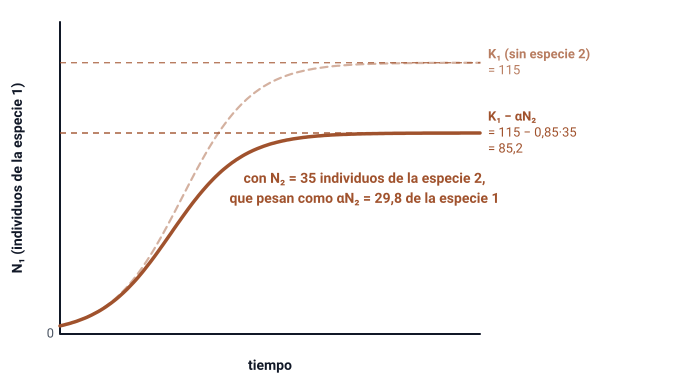
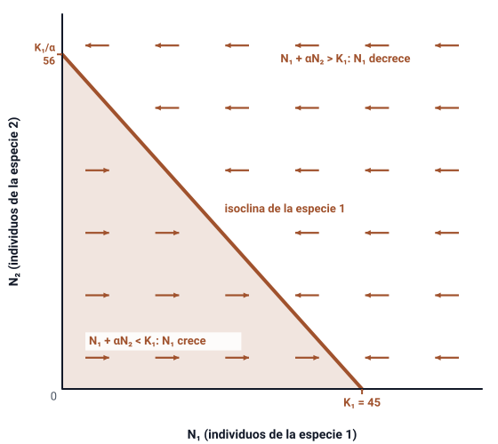
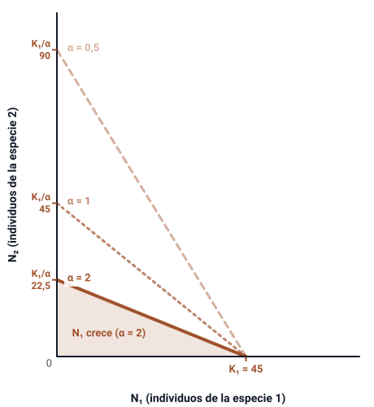
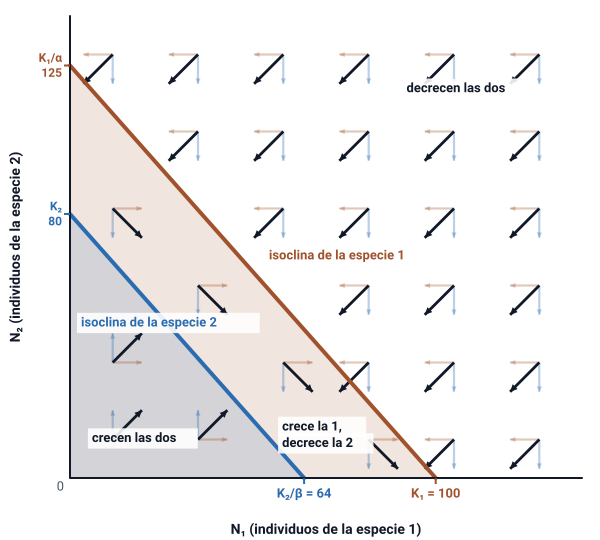
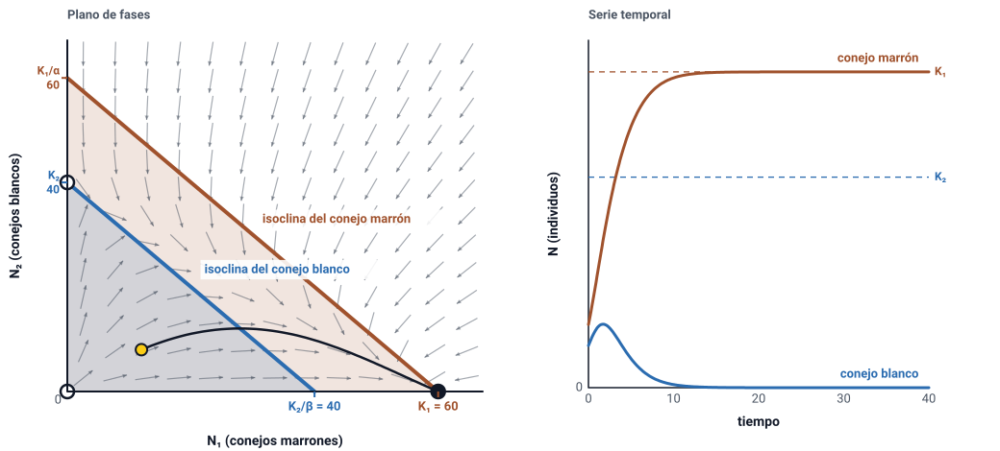
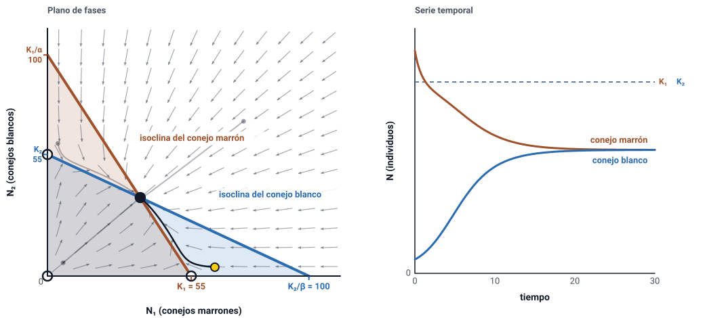

# Competencia interespecífica

> + **_Tipo de material_**: <span style="display: inline-block; font-size: 12px; color: white; background-color: #029BF9; border-radius: 5px; padding: 5px; font-weight: bold;">Teoría</span> 
> + **_Versión_**: 2026-2027
> + **_Asignatura (grado)_**: Ecología (CCAA)
> + **_Autor_**: Curro Bonet-García (fjbonet@uco.es)
> + **Duración**: Aproximadamente 2 horas.


[TOC]


## 1. Objetivos 

En esta guía se describen dos sesiones de una hora cada una. Tiene los siguientes objetivos. 

+ Definición del concepto de competencia interespecífica, que se pone de manifiesto en las comunidades ecológicas.
+ Aprender el impacto que tiene la competencia sobre el crecimiento de las poblaciones implicadas en dicha interacción. Además del ya conocido "freno" provocado por la competencia intraespecífica, analizaremos en qué medida la competencia entre especies también afecta al crecimiento poblacional. 
+ Estudiar el modelo de Lotka y Volterra como instrumento matemático para comprender el impacto de la competencia en las poblaciones de las especies afectadas.
+ Entender cómo interactúan los dos tipos de competencia que conocemos: la intraespecífica y la interespecífica. 


## 2. Introducción: de la depredación a la competencia

La competencia interespecífica se modeliza como una competencia intraespecífica ampliada: los individuos de la otra especie se convierten en individuos equivalentes de la propia. Antes de desarrollar esta idea, conviene situarla respecto a la interacción estudiada en el capítulo anterior, la depredación.

En la depredación, los tamaños poblacionales de depredadores y presas se acoplan de forma oscilatoria. Cuando aumenta el número de presas, aumenta el de depredadores. Este aumento reduce el número de presas, lo que a su vez hace descender el número de depredadores. Con menos depredadores, las presas vuelven a aumentar, y el ciclo se repite.

Las ecuaciones de Lotka-Volterra para la depredación no contemplan la competencia intraespecífica. La población de presas (N) crece de forma exponencial, a una tasa r, y a ese crecimiento se le resta el efecto del depredador (P), que depende de su capacidad para capturar presas (a). El depredador actúa, por tanto, sobre la mortalidad de la presa. La presa, en cambio, incide en el depredador por el lado de los nacimientos: cuantas más presas hay, más nacimientos de depredadores se producen (b es la eficiencia con la que las presas consumidas se convierten en nuevos depredadores y m su tasa de mortalidad).

```latex
\frac{dN}{dt} = rN - aNP \qquad \frac{dP}{dt} = b\,aNP - mP
```

El modelo de competencia que se desarrolla a continuación tiene una estructura distinta. No parte de un crecimiento exponencial, sino del crecimiento logístico, en el que la competencia intraespecífica ya está incorporada.

La **competencia interespecífica** es la interacción que se produce cuando individuos de especies distintas utilizan los mismos recursos limitantes (territorio, alimento u otros), de modo que cada especie reduce el crecimiento poblacional de la otra. Por ejemplo, compiten dos depredadores que se alimentan de la misma presa, dos herbívoros que consumen la misma planta o dos plantas cuyas raíces exploran la misma profundidad del suelo y necesitan los mismos recursos.

Esta interacción no debe confundirse con la depredación, porque ninguna de las especies consume a la otra. Una especie perjudica a la otra porque le resta alimento o espacio, o porque la agrede y le impide alimentarse. Es lo que ocurre, por ejemplo, entre conejos y liebres que comparten un mismo pastizal. Por esta razón, la competencia interespecífica se parece mucho a la intraespecífica: en ambos casos, el crecimiento de una población se frena porque hay más individuos que reclaman los mismos recursos.

## 3. El modelo de Lotka-Volterra para la competencia

El modelo de competencia interespecífica añade a la ecuación logística un único término: el efecto de la otra especie, expresado en individuos equivalentes de la propia.

El crecimiento logístico describe una población sometida a competencia intraespecífica. Al principio, el crecimiento se asemeja a una exponencial. A medida que el número de individuos (N) se acerca a la capacidad de carga (K), el crecimiento se frena y la población tiende a una asíntota en torno a ese valor, que en teoría nunca llega a alcanzar.

```latex
\frac{dN}{dt} = rN\,\frac{K - N}{K}
```

El cociente (K − N)/K actúa como un freno que se pisa con más fuerza cuanto mayor es la población. Cuando N es muy pequeño, K − N se parece mucho a K, el cociente vale casi 1 y el crecimiento es prácticamente exponencial. Cuando N se acerca a K, K − N tiende a cero y la velocidad de crecimiento se anula.

Para modelizar la competencia entre dos especies, cuantificamos cuánto perjudica cada individuo de la otra especie a un individuo de la especie que estamos modelizando. Para ello se introduce un parámetro que actúa como conversor: transforma el número de individuos de la otra especie en un número de individuos equivalentes de la propia.

Un ejemplo hipotético ayuda a entender la idea. Supongamos que un *Tyrannosaurus rex* y un oso, ambos carnívoros, compartieran territorio y presas (algo que nunca ocurrió, porque no coexistieron en el tiempo). La pregunta relevante sería cuántos osos se necesitan para competir por los recursos con un *T. rex*. No se trata de que ambas especies se enfrenten físicamente, sino de cuánto reduce cada una los recursos disponibles para la otra.

Este conversor se incorpora a la ecuación logística de la especie 1 mediante el término α·N₂:

```latex
\frac{dN_1}{dt} = r_1 N_1\,\frac{K_1 - N_1 - \alpha N_2}{K_1}
```

El **coeficiente de competencia interespecífica** (α) mide el efecto de un individuo de la especie 2 sobre el crecimiento de la especie 1, expresado en individuos equivalentes de la especie 1. Al multiplicarlo por N₂, el número de individuos de la especie 2, obtenemos el peso total de la especie 2 sobre la especie 1. Como este término se resta en el numerador, cuanto mayores sean α o N₂, antes se alcanza el freno del crecimiento.

Volvamos a un ejemplo más cercano. Si en un territorio solo hay conejos, estos compiten entre sí por la hierba y, cuando son muchos, la población alcanza la capacidad de carga y deja de crecer. Si además hay liebres, que se alimentan de forma parecida, los conejos compiten también con ellas. Cuantas más liebres haya (mayor N₂) y cuanto más perjudique cada liebre a los conejos (mayor α), más se frena el crecimiento de la población de conejos. En términos del modelo, es como si las liebres se sumaran a los conejos para alcanzar la capacidad de carga.



*Figura 1. Crecimiento de la especie 1 en ausencia de la especie 2 (línea discontinua) y en presencia de 35 individuos de la especie 2 (línea continua).*

Un ejemplo numérico lo concreta. Con una capacidad de carga K₁ = 115, la especie 1 sola crece hasta aproximarse a 115 individuos. Si hay 35 individuos de la especie 2 y el coeficiente vale α ≈ 0,85, esos 35 individuos equivalen a 29,8 individuos de la especie 1. La capacidad de carga teórica sigue siendo 115, pero la especie 1 se estabiliza en torno a 85 individuos (115 − 29,8). La conversión es necesaria porque ambos términos deben estar en las mismas unidades para poder restarse.

Si aumentamos el efecto de la especie 2 sobre la especie 1 (es decir, si aumenta α), la curva de crecimiento de la especie 1 se estabiliza en un valor más bajo. El efecto es equivalente a añadir individuos de la propia especie o, dicho de otra forma, a reducir la capacidad de carga efectiva del medio.

La especie 2 experimenta lo mismo. Su ecuación incorpora el coeficiente β, que mide el efecto de un individuo de la especie 1 sobre el crecimiento de la especie 2, multiplicado por N₁:

```latex
\frac{dN_2}{dt} = r_2 N_2\,\frac{K_2 - N_2 - \beta N_1}{K_2}
```

Las dos ecuaciones forman un sistema acoplado: el crecimiento de cada especie depende de su propia abundancia y de la abundancia de la otra.

### 3.1 El significado del coeficiente de competencia

El coeficiente de competencia resume en un solo número cuánto se parecen dos especies en sus necesidades y con qué intensidad interfieren entre sí. Su valor respecto a 1 indica si pesa más la competencia intraespecífica o la interespecífica.

#### 3.1.1 Un parámetro fenomenológico

El coeficiente α es un parámetro **fenomenológico**: describe el resultado de la interacción (cuánto perjudica la especie 2 a la especie 1) sin especificar el mecanismo que lo produce. Su valor depende de varios factores. Uno es el grado de solapamiento de las necesidades de ambas especies, ya sean alimenticias, reproductivas o de otro tipo. Otro es la territorialidad o la agresividad: una especie muy territorial perjudica activamente a la otra, lo que eleva el coeficiente. Por ejemplo, si la liebre fuera muy territorial y el conejo no, el perjuicio de las liebres sobre los conejos no dependería solo de cuántas liebres hubiera, sino también de que estas expulsan activamente a los conejos.

Cabe preguntarse cómo se mide este coeficiente, es decir, cómo se decide a cuántos conejos equivale una liebre. Que α sea fenomenológico significa que no especifica el mecanismo de la competencia, pero no que no pueda cuantificarse. Su definición es precisa: es el efecto per cápita de la especie 2 sobre la tasa de crecimiento de la especie 1, relativo al efecto per cápita de un individuo de la propia especie 1.

Existen varias vías para estimarlo:

- **Cultivos en laboratorio.** Se crían ambas especies por separado y juntas, y se ajusta el modelo a las curvas de crecimiento observadas. Así procedió Gause con protozoos del género *Paramecium*.
- **Experimentos de eliminación o adición en el campo.** Se retira o se añade un número conocido de individuos de la especie 2 y se mide cómo cambia el crecimiento o la abundancia de equilibrio de la especie 1.
- **Comparación de abundancias de equilibrio.** Si se conoce el tamaño al que se estabiliza la especie 1 con y sin la especie 2, α se obtiene de la diferencia. En el ejemplo numérico anterior, la especie 1 se estabiliza en 115 individuos sin competidor y en torno a 85 con 35 individuos de la especie 2, de modo que α ≈ (115 − 85)/35 ≈ 0,85.
- **Series temporales e índices de solapamiento.** El coeficiente puede estimarse por regresión a partir de series de abundancias de ambas especies, o aproximarse mediante índices de solapamiento de nicho calculados a partir del uso de recursos (por ejemplo, la proporción de la dieta que comparten).

Ninguna de estas estimaciones es sencilla, precisamente porque α integra factores muy diversos. A ello se añade una dificultad general: la competencia interespecífica es una relación ecológicamente importante, pero difícil de observar directamente. En el territorio no solemos ver la competencia, sino sus consecuencias, que se analizan más adelante.

#### 3.1.2 Coeficiente de competencia y nicho ecológico

La dependencia de α respecto al solapamiento de necesidades conduce a un concepto clave en ecología. El **nicho ecológico** es el conjunto de todas las necesidades, del tipo que sea, que tiene una especie para vivir en un territorio determinado.

De manera más formal, Hutchinson (1957) definió el nicho como un **hipervolumen n-dimensional**. Cada dimensión corresponde a una condición ambiental (temperatura, humedad, pH, etc.) o a un recurso (tamaño de las presas, profundidad del suelo explorada por las raíces, etc.). El hipervolumen abarca el conjunto de valores de todas esas dimensiones dentro del cual una especie puede mantener una población viable, es decir, con una tasa de crecimiento no negativa. Esta definición incluye, por tanto, las tolerancias a las condiciones del medio, y no solo las necesidades de recursos. Hutchinson distinguió además entre el **nicho fundamental**, el que ocuparía la especie en ausencia de competidores, y el **nicho realizado**, la parte de aquel que ocupa efectivamente cuando hay competencia.

El coeficiente de competencia refleja, en parte, cuánto se parecen los nichos de dos especies. Un coeficiente alto indica que los nichos se solapan mucho. Las consecuencias de ese solapamiento se analizan en el último apartado.

#### 3.1.3 Valores del coeficiente respecto a 1

El valor de α tiene una lectura directa cuando se compara con 1, porque 1 es el efecto de un individuo de la propia especie.

| Valor de α | Significado                                                  | Competencia que pesa más sobre la especie 1 |
| ---------- | ------------------------------------------------------------ | ------------------------------------------- |
| α < 1      | Un individuo de la especie 2 frena el crecimiento de la especie 1 menos que un individuo de la especie 1 | Intraespecífica                             |
| α = 1      | Un individuo de cada especie frena por igual el crecimiento de la especie 1 | Ambas por igual                             |
| α > 1      | Un individuo de la especie 2 frena el crecimiento de la especie 1 más que un individuo de la especie 1 | Interespecífica                             |

En el ejemplo hipotético del *T. rex* y el oso, el coeficiente que mide el efecto del oso sobre el *T. rex* sería menor que 1. Un oso perjudica a la población de *T. rex* menos que otro *T. rex*, porque este come más y es más competitivo. El mismo razonamiento se aplica a β, que mide el efecto de la especie 1 sobre la especie 2.

En síntesis, la competencia interespecífica se modeliza como si fuera intraespecífica. La presencia de una especie competidora hace que el crecimiento poblacional propio se frene antes, ya sea porque consume los mismos recursos o porque interfiere activamente. Cuando el coeficiente es menor que 1, frenan más el crecimiento los individuos de la propia especie; cuando es mayor que 1, lo frenan más los de la especie competidora.

### 3.2 Isoclinas de crecimiento cero

Las isoclinas de crecimiento cero dividen el plano de abundancias de las dos especies en regiones donde cada especie crece o decrece. Su posición relativa determina el desenlace de la competencia.

Para analizar la interacción representamos un plano con el número de individuos de la especie 1 (N₁) en el eje X y el de la especie 2 (N₂) en el eje Y. Cada punto del plano es una combinación de tamaños poblacionales: el punto (11, 17), por ejemplo, corresponde a 11 individuos de la especie 1 y 17 de la especie 2. La pregunta es qué especie crece y cuál decrece en cada combinación. De ello depende la dinámica poblacional, que a su vez condiciona la estructura y el funcionamiento de comunidades y ecosistemas. El procedimiento es parecido al empleado con la depredación, aunque algo más complejo.

#### 3.2.1 Isoclina de la especie 1

Buscamos primero las combinaciones de abundancias para las que la especie 1 no crece, es decir, aquellas en las que dN₁/dt = 0. Esto ocurre cuando se anula el numerador del cociente:

```latex
K_1 - N_1 - \alpha N_2 = 0 \quad\Longrightarrow\quad N_1 = K_1 - \alpha N_2
```

Es la ecuación de una recta, del tipo y = ax + b, cuyas constantes son K₁ y α. Para dibujarla basta con hallar sus dos cortes con los ejes:

- Si N₂ = 0, entonces N₁ = K₁. En el ejemplo de clase, K₁ = 45, de modo que la recta corta el eje X en (45, 0).
- Si N₁ = 0, entonces 0 = K₁ − αN₂ y, despejando, N₂ = K₁/α. La recta corta el eje Y en (0, K₁/α).



*Figura 2. Isoclina de crecimiento cero de la especie 1 (K₁ = 45, α = 0,8). Por debajo de la recta (zona sombreada), N₁ crece; por encima, decrece.*

La **isoclina de crecimiento cero** de la especie 1 es esa recta: el conjunto de combinaciones de abundancias para las que la población de la especie 1 no cambia. A cada lado de ella, el signo del numerador K₁ − N₁ − αN₂ determina si la especie 1 crece o decrece.

Por debajo de la isoclina se cumple que N₁ + αN₂ < K₁. Es decir, la suma de los individuos propios y de los individuos equivalentes de la especie 2 no alcanza la capacidad de carga. El numerador es positivo y N₁ crece. Esto ocurre cuando N₁ y N₂ son, en conjunto, bajos. Por encima de la isoclina, en cambio, N₁ + αN₂ > K₁: la suma supera la capacidad de carga, el numerador es negativo y N₁ decrece. El numerador solo vale cero sobre la propia recta.

El coeficiente α modifica la isoclina. Si α aumenta, el corte con el eje Y (K₁/α) desciende y la recta se «tumba» hacia el eje X, mientras que el corte con el eje X (K₁) no cambia. Se reduce así la región situada bajo la recta, en la que la especie 1 crece. Con un α grande, unos pocos individuos de la especie 2 bastan para que N₁ + αN₂ supere K₁. Dicho de otra forma, la especie 1 solo puede crecer cuando la especie 2 es escasa.



*Figura 3. Efecto de α sobre la isoclina de la especie 1 (K₁ = 45). Al aumentar α, el corte con el eje vertical (K₁/α) baja y la región de crecimiento se reduce, pero el corte con el eje horizontal sigue en K₁.*

Esto no significa que la especie 1 no pueda alcanzar tamaños grandes. Como el corte con el eje X sigue siendo K₁, en ausencia de la especie 2 la especie 1 puede crecer hasta su capacidad de carga, por grande que sea α. Lo que α limita es cuántos individuos de la especie 2 tolera la especie 1 sin dejar de crecer. Por ejemplo, con K₁ = 45 y α = 1, la especie 1 todavía crece en presencia de 40 individuos de la especie 2, siempre que N₁ sea menor que 5. Con α = 5, en cambio, deja de crecer en cuanto hay 9 individuos de la especie 2, aunque no quede ninguno de la especie 1.

Conviene subrayar que este diagrama todavía no incluye el tiempo. Solo muestra en qué combinaciones de abundancias crece o decrece cada especie; la evolución temporal se analiza más adelante.

#### 3.2.2 Isoclina de la especie 2

El procedimiento para la especie 2 es idéntico. Al anular su velocidad de crecimiento se obtiene otra recta:

```latex
K_2 - N_2 - \beta N_1 = 0 \quad\Longrightarrow\quad N_2 = K_2 - \beta N_1
```

Sus cortes con los ejes son (0, K₂) y (K₂/β, 0). Por debajo de esta isoclina, todas las combinaciones de abundancias de las dos especies implican que la especie 2 crece; por encima, que decrece.

#### 3.2.3 Las dos isoclinas juntas

Al superponer las dos isoclinas, el plano queda dividido en regiones:

- Por debajo de ambas isoclinas, crecen las dos especies.
- Entre las dos isoclinas, crece la especie cuya isoclina queda por encima y decrece la otra.
- Por encima de ambas isoclinas, decrecen las dos especies.

En cada punto, la combinación de ambas tendencias puede representarse como un vector que indica hacia dónde evolucionarán las dos poblaciones. La posición de las isoclinas depende de las capacidades de carga y de los coeficientes de competencia de cada especie. Según cómo se crucen, se obtienen distintas situaciones, que se corresponden con desenlaces observables en la naturaleza.



*Figura 4. Las dos isoclinas superpuestas (K₁ = 100, α = 0,8, K₂ = 80, β = 1,25). Las flechas negras combinan el cambio de cada especie (horizontal para la especie 1, vertical para la especie 2) e indican hacia dónde evoluciona el sistema en cada región.*

### 3.3 Exclusión competitiva y coexistencia

Dos especies con nichos idénticos no pueden coexistir: una desplaza a la otra. La coexistencia estable solo es posible cuando los nichos se solapan parcialmente y cada especie se limita a sí misma más de lo que limita a la otra.

#### 3.3.1 Nichos idénticos: exclusión competitiva

Imaginemos un territorio homogéneo en el que viven dos especies hipotéticas de conejo, una marrón y otra blanca. Ambas comen exactamente el mismo alimento, de modo que sus nichos se solapan al 100 % y sus coeficientes de competencia son iguales (α = β = 1). En estas condiciones, las isoclinas son paralelas y queda por encima la de la especie con mayor capacidad de carga.



*Figura 5. Exclusión competitiva con nichos idénticos (α = β = 1, K₁ = 60, K₂ = 40). Izquierda: isoclinas paralelas y trayectoria desde el punto amarillo hasta el equilibrio estable (círculo negro), en el que solo queda el conejo marrón. Derecha: la misma trayectoria frente al tiempo.*

Si partimos de una combinación inicial cualquiera, la dinámica es siempre la misma. Primero crecen ambas especies. Al cruzar la isoclina inferior, la especie correspondiente empieza a decrecer, mientras que la otra sigue creciendo. Finalmente, el sistema llega a un punto estable en el que solo queda una especie. En la simulación, llega un momento en que los conejos blancos no pueden reproducirse porque los marrones acaparan los recursos, y desaparecen. Representado frente al tiempo, ambas poblaciones crecen al principio; después, la del conejo blanco deja de crecer y declina, mientras que la del conejo marrón sigue aumentando. Si los parámetros favorecen a la otra especie, el resultado es simétrico y gana el conejo blanco.

Este resultado se conoce como **principio de exclusión competitiva**: cuando dos especies que comparten exactamente el mismo nicho ocupan el mismo territorio, una desplaza a la otra.

Queda por saber qué especie gana. Con α = β = 1 e isoclinas paralelas, gana siempre la especie con mayor capacidad de carga, cuya isoclina queda por encima. El número inicial de individuos no influye en el resultado: aunque la especie con menor capacidad de carga empiece siendo mucho más abundante, acabará desapareciendo. El desenlace depende solo de los parámetros del modelo (K₁, K₂, α y β), no de las abundancias de partida. Tampoco depende de qué especie «se adapte mejor al terreno» en un sentido general, porque el modelo no incorpora otros rasgos. Precisamente, una mayor capacidad de carga indica que la especie aprovecha mejor los recursos compartidos: puede seguir creciendo en densidades a las que la otra ya decrece.

En la naturaleza no se observa la coexistencia estable de especies con nichos idénticos en un mismo lugar (el ejemplo intuitivo del lobo y el coyote no lo es en sentido estricto). Lo que observamos son las consecuencias de la exclusión: unas especies viven en unos lugares y otras en otros. Puede que la competencia ocurriera en un lugar y un momento concretos, pero una especie se impuso y desplazó a la otra.

El ejemplo clásico de laboratorio es el de Gause (1934) con dos protozoos, *Paramecium aurelia* y *P. caudatum*. Cultivados por separado con el mismo alimento (bacterias), ambos crecen de forma logística hasta su capacidad de carga. Cultivados juntos, *P. aurelia* sigue creciendo y *P. caudatum* acaba desapareciendo, tal como predice el modelo cuando los nichos coinciden.

En el campo, el experimento de Connell (1961) con dos especies de cirrópodos (bellotas de mar) de la costa de Escocia muestra cómo la exclusión produce una distribución separada. *Chthamalus stellatus* ocupa la franja alta de las rocas intermareales y *Semibalanus balanoides*, la franja baja. Las larvas de *Chthamalus* también se asientan en la franja baja, pero allí *Semibalanus*, que crece más deprisa, las recubre, las desplaza o las aplasta. Cuando Connell retiró a *Semibalanus*, *Chthamalus* sobrevivió en la franja baja. Su ausencia de esa zona no se debía, por tanto, a que no pudiera vivir allí, sino a la exclusión competitiva: su nicho realizado es menor que su nicho fundamental. *Semibalanus*, por su parte, no ocupa la franja alta porque no tolera la desecación.


#### 3.3.2 Territorialidad y evitación de la competencia

En especies móviles, como las aves, cabe preguntarse cómo se reparten el territorio dos especies que comparten hábitat y recursos. Muchas aves, como las águilas, son territoriales: cada individuo o pareja defiende un territorio y expulsa activamente a los intrusos. La territorialidad es, sobre todo, intraespecífica: se dirige principalmente contra individuos de la misma especie, que son los que tienen exactamente las mismas necesidades. Existe también territorialidad interespecífica entre especies con nichos muy parecidos, pero es menos frecuente.

Conviene precisar que la territorialidad no evita la competencia, sino que es una forma de ella. Se trata de **competencia por interferencia**, en la que un individuo impide directamente a otro el acceso al recurso. Se distingue así de la competencia por explotación, en la que ambos consumen el mismo recurso sin enfrentarse. Lo que sí reduce la territorialidad son los enfrentamientos continuos: una vez establecidos los territorios, cada individuo explota el suyo con menos interferencias. Desde el punto de vista evolutivo, no es un «invento» para evitar peleas, sino un rasgo seleccionado porque los beneficios de controlar un recurso superan los costes de defenderlo.

Tampoco es correcto concluir que la competencia interespecífica no ocurre. Está bien documentada experimentalmente, como muestran los trabajos de Gause y Connell. Sin embargo, a lo largo de la evolución, la competencia favorece la diferenciación de los nichos de las especies que conviven, y esa diferenciación reduce su intensidad. Por eso, en el presente, a menudo observamos más sus consecuencias (especies con nichos separados o distribuciones segregadas) que la competencia en sí.

#### 3.3.3 Nichos parcialmente solapados: coexistencia

La coexistencia requiere que los nichos no se solapen al 100 %. Para simularlo, el territorio homogéneo se sustituye por una ladera. En la parte alta crece hierba baja y en la parte baja, hierba alta. Los conejos blancos están adaptados a comer hierba baja, mientras que a los marrones les cuesta más. Los nichos se solapan, pero solo en parte. En la zona intermedia pueden vivir ambas especies; es poco común que un conejo marrón llegue a la parte alta, y los conejos blancos que bajan a la parte baja son desplazados por los marrones.

En esta situación, las isoclinas se cruzan de modo que cada una corta el eje de su propia especie por debajo del corte de la otra isoclina. La razón es que, en la zona de solapamiento, lo que más limita a cada especie no son los individuos de la otra, sino los de la suya. Dicho de otra forma, la competencia intraespecífica pesa más que la interespecífica. Formalmente, la coexistencia estable exige que se cumplan a la vez:

```latex
\alpha < \frac{K_1}{K_2} \qquad \text{y} \qquad \beta < \frac{K_2}{K_1}
```



*Figura 6. Coexistencia con nichos parcialmente solapados (α = β = 0,55, K₁ = K₂ = 55). Izquierda: las isoclinas se cruzan en un equilibrio estable (círculo negro), al que llegan las trayectorias desde cualquier punto de partida. Derecha: evolución temporal desde el punto amarillo, con muchos conejos marrones y pocos blancos.*

Al poner en marcha el modelo desde cualquier combinación inicial, primero crecen ambas especies, después solo una, y siempre se alcanza el mismo punto de equilibrio, situado en el cruce de las dos isoclinas. El resultado es el mismo si se parte de muchos individuos de una especie y pocos de la otra, o al revés. Ese equilibrio es un único par de abundancias totales: un valor de N₁ y otro de N₂ que se mantienen constantes. El modelo de Lotka-Volterra no es espacial, de modo que no dice dónde se sitúan los individuos de cada especie.

La ladera sirve para entender por qué los coeficientes de competencia son pequeños en este caso. Como cada especie se alimenta preferentemente de un tipo de hierba, los individuos de la otra especie apenas le restan recursos (α y β bajos), y esa diferenciación de nichos es lo que hace posible el equilibrio. Sobre el terreno, la diferenciación se traduce en una distribución esperable: muchos conejos blancos en la parte alta, muchos marrones en la parte baja y una mezcla de ambos en la zona intermedia, que es donde compiten realmente. Esta distribución es una interpretación del mecanismo, no un resultado del modelo.

En los extremos del gradiente, la otra especie apenas molesta, porque su nicho está en otra parte. Solo hay competencia interespecífica en la zona intermedia, donde operan ambos tipos de competencia. Aun así, allí pesa más la intraespecífica: lo que impide crecer a los conejos marrones son, sobre todo, los propios conejos marrones, y lo mismo ocurre con los blancos. Si pesara más la interespecífica, una especie desplazaría a la otra.

En la realidad no existe una línea nítida que separe a ambas especies, sino un gradiente. Un conejo marrón puede subir a comer hierba de altura intermedia y encontrarse con un conejo blanco que lo expulse o lo estorbe; en ese caso hay competencia interespecífica. Sin embargo, a cada conejo le perjudican más los de su propia especie, porque comen una hierba más parecida a la suya. A medida que se asciende por la ladera, la proporción de conejos blancos aumenta, y a medida que se desciende, la de marrones. Esta situación, a diferencia de la anterior, sí se observa en la naturaleza.

### 3.4 Síntesis

Dos ideas resumen este tema. La primera es metodológica: la competencia interespecífica se estudia transformando los individuos de la especie competidora en individuos equivalentes de la propia, mediante el coeficiente de competencia, y añadiéndolos al freno de la ecuación logística. La segunda es ecológica: la coexistencia entre especies es estable cuando la competencia intraespecífica pesa más que la interespecífica. Cuando los nichos son idénticos, una especie excluye a la otra, y lo que observamos en la naturaleza son las consecuencias de esa exclusión más que la competencia en sí.

De esta segunda idea se desprende una lectura más general: la estabilidad de un sistema de especies descansa en la autocontención, es decir, en que cada población esté limitada sobre todo por sí misma.


****

[Aquí](https://github.com/aprendiendo-cosas/Te_comunidades_comp_inter_ecologia_ccaa/archive/refs/tags/2025_2026.zip) puedes descargar un archivo .zip que contiene este guión en formato html y todo el material que incluye.

****
Haz click [aquí](https://github.com/aprendiendo-cosas/Te_comunidades_comp_inter_ecologia_ccaa/releases) para ver cómo ha cambiado este guión en los distintos cursos académicos.

---

[Aquí](https://github.com/aprendiendo-cosas/Te_comunidades_comp_inter_ecologia_ccaa/blob/2026_2027/notas_imparticion_Te_comunidades_comp_inter_ecologia_ccaa.md) puedes ver las notas que tomó el profesor una vez que se impartió la clase.

****
 <p xmlns:cc="http://creativecommons.org/ns#" >El contenido de este repositorio se puede utilizar bajo la siguiente licencia:  <a  href="https://creativecommons.org/licenses/by-nc-sa/4.0/?ref=chooser-v1"  target="_blank" rel="license noopener noreferrer"  style="display:inline-block;">CC BY-NC-SA 4.0</a></p> 

<p>Esta licencia no aplica a enlaces a artículos, libros o imágenes no originales. Estos productos tienen su licencia correspondiente.</p>

